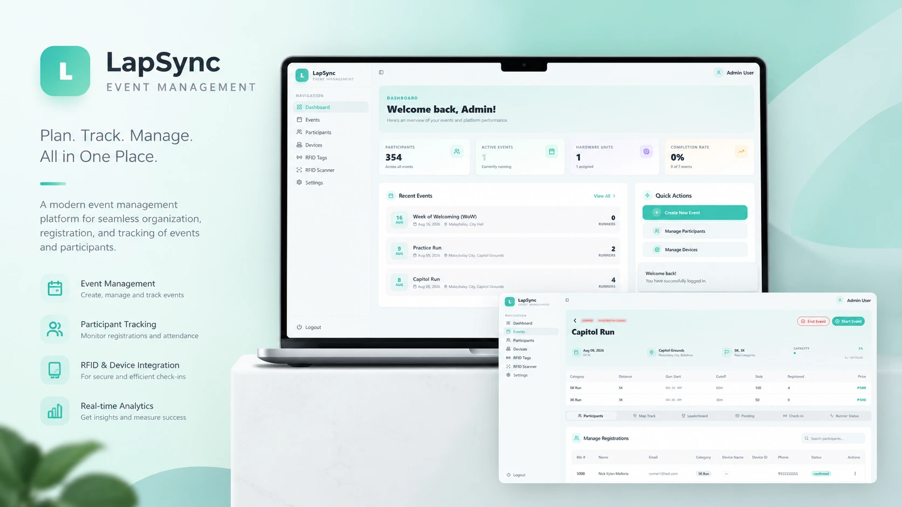

# LapSync — Race Event Management System

LapSync is a full-stack race event management system built for event organizers and participants. It handles everything from pre-race registration and payments to real-time telemetry, RFID-based timing, live GPS tracking, and post-race results — all in one platform.



---

## Features

### Admin Dashboard

- Manage events with multiple **race categories**, slots, pricing, cutoff times, and gun start times
- View live **race progress** across all participants during an active event
- Monitor **RFID tags** — assign, retire, and track tag status per runner
- Manage **IoT devices** paired to runner registrations
- View **analytics and reports** per event
- Manage **participant registrations** and payment statuses
- Configure application-wide **settings**

### Public Portal

- Browse and spectate **upcoming and live events** without an account
- View event details, race categories, and location information

### Participant (Client) Portal

- Register and pay for race categories via **PayMongo** (GCash, PayMaya, GrabPay, Card)
- View personal **race progress** in real-time during active events
- Track **checkpoints**, pace, heart rate, and position live
- Browse **completed events** and personal race history
- View **leaderboards** per event

### Mobile App (Expo / React Native)

- Companion app for admins and participants (Android & iOS)
- Live race monitoring with **React Native Maps**
- Real-time socket-based updates

### Real-Time Engine

- **Socket.IO** powers all live race updates
- Devices emit `raceUpdate` events (position, pace, heart rate, EMG, checkpoint status)
- Server broadcasts targeted updates to registered race rooms:
  - `positionUpdate` — GPS coordinates
  - `timeUpdate` — elapsed time & pace
  - `bioSignalUpdate` — heart rate, EMG zone, health warnings
  - `checkpointUpdate` — next checkpoint, distance, estimated arrival

### Security & Auth

- JWT-based authentication with **HTTP-only cookie sessions**
- Google OAuth integration
- Password reset via email (Nodemailer + Gmail)
- reCAPTCHA protection
- Role-based route protection (Admin vs. Client)

---

## Tech Stack

| Layer            | Technology                                          |
| ---------------- | --------------------------------------------------- |
| **Frontend**     | React 18, Vite, TypeScript, Tailwind CSS, shadcn/ui |
| **State / Data** | TanStack Query, Zustand, React Hook Form + Zod      |
| **Maps**         | Leaflet, React Leaflet, Leaflet Routing Machine     |
| **Charts**       | Recharts                                            |
| **Mobile**       | React Native (Expo), NativeWind, React Native Maps  |
| **Backend**      | Node.js, Express 5, TypeScript                      |
| **Realtime**     | Socket.IO                                           |
| **Database**     | MongoDB, Mongoose                                   |
| **Auth**         | JWT, bcryptjs, Google OAuth (`googleapis`)          |
| **Payments**     | PayMongo (GCash, PayMaya, GrabPay, Card)            |
| **Email**        | Nodemailer (Gmail)                                  |
| **Validation**   | Zod (server & client)                               |

---

## Project Structure

```
lapsync/
├── client/          # React web app (Admin + Client portals)
│   └── src/
│       ├── pages/
│       │   ├── admin/       # Admin-only pages
│       │   ├── client/      # Participant-facing pages
│       │   ├── public/      # Public landing & event spectate
│       │   └── auth/        # Login, Signup, Password reset
│       ├── components/      # Shared UI components
│       ├── services/        # Socket.IO client setup
│       ├── stores/          # Zustand global state
│       └── types/           # Shared TypeScript types
│
├── server/          # Express REST API + Socket.IO server
│   └── src/
│       ├── controllers/     # Route handlers
│       ├── models/          # Mongoose schemas
│       ├── routes/          # API route definitions
│       ├── services/        # PayMongo, email, auth logic
│       ├── sockets/         # Socket.IO race event handlers
│       ├── middlewares/     # Auth, error handling, CORS
│       └── utils/           # JWT, GPS, cookie utilities
│
├── mobile/          # Expo React Native app
│   └── app/
│       ├── (admin)/         # Admin mobile screens
│       ├── (client)/        # Participant mobile screens
│       └── (auth)/          # Auth screens
│
└── data/            # Local MongoDB data directory
```

---

## Getting Started

### Prerequisites

- **Node.js** v18+
- **MongoDB** (running locally or via Atlas)
- **npm** or **bun**

### Installation

```bash
# Clone the repository
git clone <repo-url>
cd lapsync

# Install all dependencies (server, client, mobile)
npm run install-all
```

### Environment Variables

Create a `.env` file inside `server/` and `client/`:

**`server/.env`**

```env
PORT=5000
MONGO_URI=mongodb://localhost:27017/lapsync
JWT_SECRET=your_jwt_secret
JWT_REFRESH_SECRET=your_refresh_secret
FRONTEND_URL=http://localhost:5173
EMAIL_USER=your_gmail@gmail.com
EMAIL_PASS=your_gmail_app_password
PAYMONGO_SECRET=your_paymongo_secret_key
GOOGLE_CLIENT_ID=your_google_client_id
GOOGLE_CLIENT_SECRET=your_google_client_secret
RECAPTCHA_SECRET_KEY=your_recaptcha_secret
```

**`client/.env`**

```env
VITE_API_URL=http://localhost:5000
```

### Running in Development

```bash
# Start MongoDB + Server + Client simultaneously
npm run dev-all
```

Or start them individually:

```bash
# Start the database
npm run db

# Start the server (from /server)
npm run dev --prefix server

# Start the client (from /client)
npm run dev --prefix client

# Start the mobile app (from /mobile)
cd mobile && npx expo start
```

### Building for Production

```bash
# Build both client and server
npm run build-all
```

---

## API Overview

All API routes are prefixed with `/api/v1/`. Protected routes require a valid session cookie.

| Route                  | Description                                         |
| ---------------------- | --------------------------------------------------- |
| `/auth`                | Login, signup, logout, Google OAuth, password reset |
| `/event`               | CRUD for race events and categories                 |
| `/registration`        | Participant registration per event                  |
| `/payment`             | PayMongo checkout session creation & verification   |
| `/device`              | IoT device management and token assignment          |
| `/rfid-tag`            | RFID tag inventory and runner assignment            |
| `/rfid-device-mapping` | Map RFID tags to tracking devices                   |
| `/telemetry`           | GPS + biometric telemetry data ingestion            |
| `/race-result`         | Runner results, rankings, and checkpoint times      |
| `/race-checkpoint`     | Checkpoint definitions per event/category           |
| `/alert`               | Race alerts and notifications                       |
| `/user`                | User profile management                             |
| `/settings`            | Application settings                                |
| `/public`              | Unauthenticated routes for public event browsing    |

---

## Data Models

| Model              | Key Fields                                                                          |
| ------------------ | ----------------------------------------------------------------------------------- |
| **Event**          | name, date, location (GPS coords), race categories, registration window, status     |
| **RaceCategory**   | name, distanceKm, cutoffTime, gunStartTime, price, slots                            |
| **RaceResult**     | runner, event, RFID tag, start/finish time, checkpoints, elapsed ms, rank, status   |
| **RaceCheckpoint** | event, category, name, type (start/finish/checkpoint/waypoint), GPS location, order |
| **Telemetry**      | registration, GPS (lat/lon), heart rate, EMG                                        |
| **Device**         | name, registration link, device token, active status                                |
| **RfidTag**        | EPC code, label, status (available/assigned/retired), linked registration/event     |

---

## License

ISC
